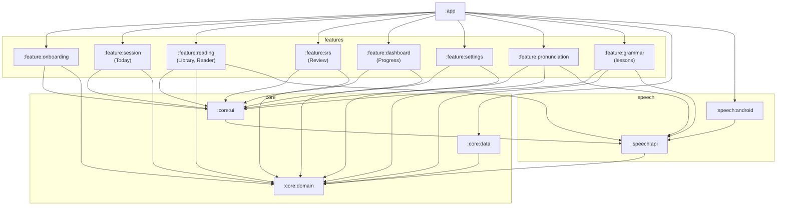

# Architecture

A map of the project, to find your way around quickly. The detailed *why* behind each choice and likely defence questions are in [`docs/understanding/architecture.md`](docs/understanding/architecture.md); the full specification is [`SPEC.md`](SPEC.md).

Status: **reading loop** (branch `feature/reading-loop`). Texts, lexicon and lessons are sample data in memory; what the learner does (word statuses, review cards, logs) is stored in **Room**, and their settings in **DataStore**. Speech synthesis runs on the device. No networking or AI yet.

The app has four tabs (SPEC §4): **Today**, **Library**, **Review**, **Progress**, plus a first-launch **onboarding** and **Settings**.

---

## 1. In one sentence

A **multi-module** Android app using **MVVM with unidirectional data flow**: Compose screens observe a `StateFlow` exposed by a ViewModel, which reads **repositories** defined as interfaces; only `:app` picks the implementations, with **Hilt**.

```
Composable  ───event───►  ViewModel  ──►  Repository / TextToSpeech (interfaces)
    ▲                         │                       ▲
    └─── StateFlow<UiState> ──┘          implementations wired by :app (Hilt)
```

---

## 2. Modules

Three families, one rule: **a feature only sees `:core:*` and `*:api` modules**, never an implementation or another feature.



| Module | Kind | Contents today |
|---|---|---|
| `:app` | Android | `MainActivity`, navigation graph, Hilt modules (`di/`) |
| `:core:domain` | Pure Kotlin | Models (`ReadingText`, `Lemma`, `ReviewCard`, `UserPreferences`, `Lesson`…), repository interfaces, and the rules: tokenizer and comprehension (`reading/`), FSRS scheduler (`review/`), streak / minutes / known words (`progress/`) |
| `:core:data` | Android | Sample content (`sample/`), in-memory repositories for content, Room database (`database/`) and DataStore for the learner's data |
| `:core:ui` | Android + Compose | Theme, `AppScaffold`, `GlassCard`, listening components, content labels and badges, choice chips, `AppLanguage` (per-app UI language), localisation helpers |
| `:core:testing` | Pure Kotlin | `MainDispatcherRule` and fake repositories shared by the feature tests |
| `:speech:api` | Pure Kotlin | `TextToSpeech` interface, `SpeechPlayer` (one text at a time) |
| `:speech:android` | Android | `AndroidTextToSpeech`: the phone's speech engine |
| `:speech:fake` | Pure Kotlin | `FakeTextToSpeech` for tests |
| `:feature:onboarding` | Feature | First launch: languages, level test, daily goal |
| `:feature:session` | Feature | Today: daily goal, reviews due, next text |
| `:feature:reading` | Feature | Library (texts, lessons, pronunciation) and Reader with the word sheet |
| `:feature:srs` | Feature | Review session (FSRS) |
| `:feature:dashboard` | Feature | Progress: stats, known-words chart, activity calendar |
| `:feature:settings` | Feature | UI language, learning language, daily goal, pronunciation help |
| `:feature:pronunciation` | Feature | Pronunciation exercise detail (opened from the Library) |
| `:feature:grammar` | Feature | Lesson detail (opened from the Library) |
| `:lang:api`, `:lang:ro-ro`, `:lang:en-gb`, `:lang:test` | Pure Kotlin | Language-specific rules (e.g. Romanian cedilla → comma-below). **Not wired into the app yet.** |

**Empty modules planned by the spec** (§11.1): `:core:network`, `:core:audio`, `:ai:*`, `:speech:azure`, `:feature:oral`, and `:feature:oral`.

Pure Kotlin modules (`*:api`, `:core:domain`) use *explicit API mode* and have no Android dependency, so they are tested on the JVM.

---

## 3. Anatomy of a screen

Every screen follows the same pattern (example: `feature/grammar/.../detail/`):

| File | Role |
|---|---|
| `XxxViewModel.kt` | Reads route arguments from the `SavedStateHandle`, turns repository `Flow`s into a `StateFlow<XxxUiState>` (`stateIn(WhileSubscribed(5_000))`), exposes `onXxx()` functions for events. |
| `XxxUiState` (same file) | `sealed interface`: `Loading`, `Success(...)`, `NotFound`. |
| `XxxScreen.kt` | `XxxScreen` (stateful: gets the ViewModel with `hiltViewModel()`) and `XxxContent` (stateless: previewable and testable). |
| `navigation/XxxNavigation.kt` | `@Serializable` routes, a `navigateToXxx()` function, a `NavGraphBuilder.xxxScreens()` extension. |

---

## 4. Navigation

- **Type-safe** routes. Tabs: `Today`, `Library`, `Review`, `Progress`. Others: `Onboarding`, `Settings`, `Reader(textId)`, `LessonDetail(lessonId)`, `PronunciationDetail(exerciseId)`. The old `LessonList` and `PronunciationList` routes are still registered but nothing opens them.
- `:app` assembles them in [`LanguageLearningNavHost.kt`](app/src/main/kotlin/com/sazerat/languagelearning/navigation/LanguageLearningNavHost.kt), with the bottom bar (shown on tab destinations only). The **list of languages** offered is also declared there.
- Switching tab pops back to the start destination and saves / restores each tab's state (except Review, which always starts a fresh session).
- The start destination is `Onboarding` until `onboardingDone` is saved in DataStore; `MainActivity` waits for that value before drawing the graph.
- Features do not know each other: they receive callbacks (`onReadText(textId)`, `onOpenReview`).
- Process death: the back stack is restored by `rememberNavController()`, screen state (open word, translated sentences, review position…) by the `SavedStateHandle`, and everything the learner did is already in Room.

---

## 5. Dependency injection (Hilt)

Only `:app` knows which implementation sits behind each interface:

| Interface | Current implementation | File |
|---|---|---|
| `PronunciationRepository`, `LessonRepository` | `InMemory…Repository` | [`di/DataModule.kt`](app/src/main/kotlin/com/sazerat/languagelearning/di/DataModule.kt) |
| `TextRepository`, `LexiconRepository` | `InMemory…Repository` (sample texts and lexicon) | same |
| `WordStatusRepository`, `ReviewRepository`, `ReadingLogRepository` | `Room…Repository` | same |
| `UserPreferencesRepository` | `DataStoreUserPreferencesRepository` | same |
| `Clock` | `SystemClock` | same |
| `TextToSpeech` | `AndroidTextToSpeech` (singleton) | [`di/SpeechModule.kt`](app/src/main/kotlin/com/sazerat/languagelearning/di/SpeechModule.kt) |

Downloading content packs (M2), or adding Azure, only touches these files and the new module, never a feature.

---

## 6. Content

- All content is hard-coded in [`core/data/.../sample/`](core/data/src/main/kotlin/com/sazerat/languagelearning/core/data/sample/): graded texts (mainly Romanian, a few in English and French), their lexicon (`Lexicon.kt`: lemmas with frequency rank, meanings, IPA), lessons 1 to 3 for each language, and pronunciation exercises.
- Texts are **pre-tokenised**: each token points to its lemma, so *casei* and *casa* are the same word. The tokenizer in `:core:domain` is used to build and test them.
- **All texts, translations and IPA were written by the AI and need a native speaker's review.**
- Every lesson and exercise carries its language (`languageCode`): repositories filter by language, and screens never assume a particular language.
- Every text shown to the learner (titles, explanations, instructions, translations of examples) is a `LocalizedText` written in English, French and Romanian (see §7).
- In M2, content will come from the API as language packs and be stored in Room (SPEC §9.2–9.3).

---

## 7. UI languages

The app has two separate notions of language:

| | What | Where it comes from |
|---|---|---|
| **Language being learnt** | English, Romanian or French | Onboarding or Settings → `UserPreferences.learningLanguage` (DataStore) |
| **UI language** | English (default), French or Romanian | The phone's language, or the per-app language (`LocaleManager`, set in onboarding, Settings or the system settings) |

- **Buttons, titles, messages**: string resources in `values/` (English), `values-fr/`, `values-ro/` of each module. Lint fails the build if a translation is missing.
- **Learning content**: `LocalizedText` (`:core:domain`), one text per UI language; `localized()` (`:core:ui`) picks the UI language, English otherwise. A single English entry means "same for everyone" (e.g. "ship / sheep").
- **Per-app language**: `generateLocaleConfig` in `app/build.gradle.kts` lets Android 13+ offer the app's languages in Settings › Apps › Languages.
- Translations of lesson examples are hidden when the UI language is the language being learnt.

---

## 8. Speech synthesis

```
Tap on a card / Play in the Reader ─► ViewModel ─► SpeechPlayer.play()
    ─► TextToSpeech.speak(text, language, rate)   (suspend, cancellable)
    ─► AndroidTextToSpeech: background thread, phone's speech engine
```

- **On-device** by choice (SPEC §10.1): responsive, works offline, free, no key to protect.
- `SpeechPlayer` plays one text at a time: a new tap cancels the previous one.
- The Reader speaks a text **sentence by sentence**, highlighting the current sentence, at 0.75×, 1× or 1.25×.
- Engine calls never run on the main thread (that was the cause of the lag fixed in M1).
- Missing voice: a snackbar with a shortcut to the system text-to-speech settings.

---

## 9. Build, quality, CI

- **Convention plugins** in [`build-logic/convention/`](build-logic/convention/src/main/kotlin/): a module only declares `languagelearning.android.feature` (or `.library`, `.jvm.library`…) and inherits the SDK levels, Java 21, Compose, Hilt/KSP.
- Versions are centralised in [`gradle/libs.versions.toml`](gradle/libs.versions.toml).
- Kotlin **and** Lint warnings are treated as errors.
- GitHub Actions CI ([`.github/workflows/ci.yml`](.github/workflows/ci.yml)): `assembleDebug`, `test`, `lintDebug`.

Run before every PR:

```bash
./gradlew assembleDebug test lintDebug
```

---

## 10. Tests

| Where | What |
|---|---|
| `core/domain/src/test` | `LocalizedText`, tokenizer, comprehension, FSRS scheduler, progress (streak, minutes, known words) |
| `core/data/src/test` | Content consistency (unique ids, IPA, every text in the three UI languages, every token linked to a lemma, no cedilla in Romanian…), repository filtering |
| `core/data/src/androidTest` | Room repositories (emulator) |
| `speech/api/src/test` | `SpeechPlayer` (cancellation, errors) |
| `feature/*/src/test` | ViewModels, with the fakes from `:core:testing` and `FakeTextToSpeech` |
| `feature/pronunciation/src/androidTest` | One instrumented Compose test (emulator) |

---

## 11. Recipes

**Add a language**
1. Add its code to `studiedLanguages` in `LanguageLearningNavHost.kt`.
2. Add texts, lexicon and lessons with that `languageCode` in `core/data/.../sample/` (from M2: publish a pack on the API).
3. If the language has its own writing rules: a `:lang:<code>` module implementing `LanguagePack`.

No screen changes; the displayed name ("Roumain") comes from Android.

**Add a UI language**
1. A `values-xx/strings.xml` in every module that has strings.
2. Add `xx` to `supportedUiLanguages` in `core/ui/.../Localization.kt`, and an `xx` translation to every `LocalizedText` of the content.

Lint and `SampleContentTest` list what is missing.

**Add a screen**
1. In the relevant feature: `XxxViewModel` + `XxxUiState`, `XxxScreen` + `XxxContent`, a `@Serializable` route.
2. Register it in the feature's `NavGraphBuilder.xxxScreens()`.
3. A ViewModel test using fakes.

**Plug in a new implementation** (content API, Azure…)
1. A new module (or class) implementing the domain interface.
2. Change the `@Provides` in `app/.../di/`.

---

## 12. Further reading

| Topic | Where |
|---|---|
| Why each choice was made, defence questions | [`docs/understanding/architecture.md`](docs/understanding/architecture.md), [`docs/understanding/reading-loop.md`](docs/understanding/reading-loop.md) |
| Manual checks performed | [`docs/verifications.md`](docs/verifications.md) |
| Specification, M2/M3 milestones | [`SPEC.md`](SPEC.md) (§9 architecture, §10 placement, §11 modularity, §14 milestones) |
| AI use log | [`AI_USE_LOG.md`](AI_USE_LOG.md) |
